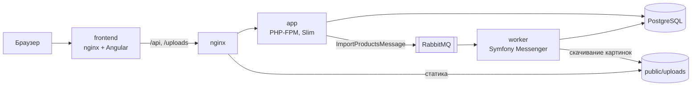

# Импорт товаров из xlsx — Slim + Doctrine + Angular

Тестовое задание: импорт товаров из `.xlsx`/`.ods` в реляционную БД через асинхронную очередь, каталог товаров с серверной пагинацией и карточкой товара.

- **Импорт** — загрузка файла, обработка в фоне (Symfony Messenger + RabbitMQ), прогресс в реальном времени, отчёт об ошибках по строкам, повторный импорт без дубликатов (upsert по внешнему коду), скачивание картинок.
- **Каталог** — список с поиском, фильтром по цене и пагинацией на сервере, состояние на NgRx.
- **Карточка** — все поля товара, дополнительные атрибуты, галерея изображений.
- **Вход** — JWT-аутентификация: страница входа, защита маршрутов на фронтенде и всех эндпоинтов данных на бэкенде.

## Стек

| Слой | Технологии |
|------|-----------|
| Backend | PHP 8.3, Slim 4, PHP-DI, Doctrine ORM 3 + Migrations, Symfony Messenger, PhpSpreadsheet, Guzzle |
| Очередь | RabbitMQ (транспорт AMQP), отдельный контейнер-воркер |
| БД | PostgreSQL 16 |
| Frontend | Angular 22 (standalone, strict), Angular Material, NgRx Store + Effects |
| Тесты | PHPUnit 11, Vitest, Playwright |
| Качество | PHPStan (level 6) + phpstan-doctrine, PHP CS Fixer, GitHub Actions |
| Инфраструктура | Docker Compose, multi-stage сборка образов, nginx |

## Быстрый старт

Нужны только **Docker** (с Docker Compose) и **make**.

```bash
git clone <repo-url> products-import
cd products-import
make init
```

`make init` создаст `.env` из `.env.example`, соберёт образы, установит зависимости, применит миграции и создаст пользователя. Первый запуск занимает несколько минут.

Вход в приложение: **`admin` / `admin12345`** (задаются в `.env`: `ADMIN_USERNAME`, `ADMIN_PASSWORD`).

| Адрес | Что там |
|------|---------|
| http://localhost:8081 | Приложение (собранный Angular), вход `admin` / `admin12345` |
| http://localhost:8081/api/docs | Swagger UI |
| http://localhost:8080/api/health | Health check |
| http://localhost:15672 | RabbitMQ (логин `app`, пароль `secret`) |

Дальше можно:

- загрузить файл-пример на странице «Импорт» (`backend/tests/fixtures/import_example.ods`) или выполнить `make import`;
- либо заполнить базу тестовыми данными с картинками: `make fixtures`.

## Команды

| Команда | Описание |
|---------|----------|
| `make init` | Первый запуск: `.env`, сборка, зависимости, миграции |
| `make up` / `make down` | Запустить / остановить контейнеры |
| `make import` | Импортировать файл-пример через API (с входом под пользователем из `.env`) |
| `make user` | Создать пользователя из `.env` или сменить ему пароль; свой: `make user args="login password"` |
| `make fixtures` | Загрузить фикстуры: 30 товаров с атрибутами и картинками (очищает БД) |
| `make migrate` / `make migrations-diff` | Применить / сгенерировать миграции |
| `make worker-logs` / `make worker-restart` | Логи воркера / перезапуск после изменений кода |
| `make test` | Тесты бэкенда: unit, интеграционные, API |
| `make front-test` | Unit-тесты фронтенда (Node.js в Docker) |
| `make e2e` | E2E-тесты Playwright на запущенном стеке |
| `make phpstan` / `make cs` / `make cs-fix` | Статический анализ / проверка / исправление стиля |
| `make quality` | PHPStan + CS Fixer + тесты |
| `make front-start` | Dev-сервер Angular на :4200 с проксированием API (нужен Node.js 22) |

## Архитектура



### Как работает импорт

1. `POST /api/import` — `ImportController` передаёт файл в `ImportLauncher`: проверка (расширение, MIME по содержимому, размер), сохранение файла, создание `ImportJob`, отправка сообщения в RabbitMQ. Клиент сразу получает `202` и ID задачи.
2. Воркер получает сообщение и запускает `ImportService`. Каждая строка обрабатывается независимо:
   - `ProductRowParser` валидирует и нормализует строку; невалидная строка попадает в отчёт, импорт продолжается;
   - картинки скачиваются **до** транзакции, чтобы сетевые запросы не держали её открытой;
   - товар, атрибуты и записи о картинках сохраняются **в одной транзакции**;
   - upsert по `external_code`: существующий товар обновляется, атрибуты и картинки синхронизируются.
3. Фронтенд раз в секунду опрашивает `GET /api/import/{id}` и показывает прогресс, счётчики, ошибки и предупреждения.

### Структура бэкенда

```
backend/
├── bin/console              консоль: миграции, воркер, фикстуры
├── config/                  DI-контейнер, маршруты, middleware, настройки
├── migrations/              миграции Doctrine
├── openapi/openapi.yaml     спецификация API
├── src/
│   ├── Controller/          тонкие контроллеры: запрос → сервис → ответ
│   ├── Entity/              Product, ProductAttribute, ProductImage, ImportJob
│   ├── Repository/          все запросы к БД
│   ├── Service/Import/      импорт: парсер, чтение файла, скачивание картинок, запуск задачи
│   ├── Service/Product/     чтение каталога, параметры списка
│   ├── Message*/            сообщение очереди и его обработчик
│   ├── Middleware/          rate limiting
│   ├── Presenter/           сущности → JSON
│   └── DataFixtures/        фикстуры для трёх таблиц
└── tests/                   Unit, Integration, Api
```

### Структура фронтенда

```
frontend/src/app/
├── models/          интерфейсы Product, ProductAttribute, ProductImage, ImportJob…
├── services/        ProductService, ImportService (HttpClient только здесь)
├── store/products/  NgRx: actions, reducer, effects, selectors
├── core/            HTTP-интерсептор ошибок, общие утилиты
├── pages/           import, product-list, product-detail (lazy loading)
└── app.routes.ts    маршрутизация
```

## Формат файла

| Колонка | Куда попадает |
|---------|---------------|
| `Внешний код` | `products.external_code` (обязательная, ключ для upsert) |
| `Наименование` | `products.name` (обязательная) |
| `Описание` | `products.description` |
| `Цена: Цена продажи` | `products.price` (обязательная; `1 320,00` и `1320.00` поддерживаются) |
| `Закупочная цена` | только для расчёта скидки |
| `Доп. поле: Ссылки на фото`, `Доп. поле: Ссылка на упаковку` | `product_images` (ссылки через запятую) |
| `Доп. поле: <ключ>` | `product_attributes` (`key` — текст после префикса) |
| остальные | игнорируются |

Скидка: `discount = (Цена продажи − Закупочная цена) / Цена продажи × 100`, округление до 2 знаков.

## API

Полная спецификация — `backend/openapi/openapi.yaml`, интерактивно — http://localhost:8081/api/docs.

Все эндпоинты, кроме входа, health check и документации, требуют заголовок `Authorization: Bearer <token>`.

| Метод | Путь | Описание |
|-------|------|----------|
| `POST` | `/api/auth/login` | Вход: `{"username", "password"}` → JWT. Не более 10 попыток в минуту с IP |
| `GET` | `/api/auth/me` | Текущий пользователь |
| `POST` | `/api/import` | Загрузить файл (multipart, поле `file`), ответ `202` + задача. Не более 5 загрузок в минуту с IP |
| `GET` | `/api/import/{id}` | Статус, прогресс, ошибки и предупреждения задачи |
| `GET` | `/api/products?page=1&limit=20&name=&price_min=&price_max=` | Список с пагинацией и фильтрами |
| `GET` | `/api/products/{id}` | Карточка товара |
| `GET` | `/api/health` | Проверка БД и очереди |

Ошибки возвращаются в едином формате: `{"error": {"message": "...", "fields": {...}}}`.

## Тесты

| Набор | Что проверяется | Запуск |
|-------|-----------------|--------|
| Unit (PHPUnit) | парсер строк, расчёт скидки, параметры списка, сущности, загрузчик картинок (SSRF, недоступный хост), rate limiting, JWT | `make test` |
| Integration (PHPUnit) | CRUD товаров на PostgreSQL, полный импорт файла-примера, повторный импорт без дубликатов, отчёт по битым строкам | `make test` |
| API (PHPUnit) | все эндпоинты через Slim-приложение целиком, загрузка файла уходит в очередь, вход, защита маршрутов, поддельные и истёкшие токены | `make test` |
| Frontend (Vitest) | reducer, селекторы, эффекты (включая debounce), сервисы (включая остановку polling и сессию), guard, интерсептор, страница списка | `make front-test` |
| E2E (Playwright) | вход и выход, редирект без входа, неверный пароль; загрузка файла → прогресс → список → поиск → карточка; неподходящий файл; 404 | `make e2e` |

Тесты бэкенда работают с отдельной базой `products_test` (создаётся автоматически) и очередью в памяти. Защита: тесты не запустятся, если имя БД не заканчивается на `_test`.

## Качество кода и CI

- **PHPStan** level 6 с `phpstan-doctrine` (проверка маппинга и DQL) — `make phpstan`;
- **PHP CS Fixer** (PER-CS 2.0 + PHP 8.3) — `make cs`, `make cs-fix`;
- **GitHub Actions** (`.github/workflows/ci.yml`) на каждый push и pull request: PHPStan, CS Fixer, PHPUnit на PostgreSQL; тесты и сборка фронтенда; сборка production-образов; e2e на полном стеке.

## Принятые решения

- **Поддержка `.ods`.** Файл-пример из задания в формате `.ods`, поэтому импорт принимает и `.xlsx`, и `.ods`.
- **Ссылки на картинки — в `product_images`, а не в атрибуты.** Иначе одни и те же ссылки дублировались бы в двух таблицах.
- **Прогресс и отчёт об ошибках — на странице импорта.** В ТЗ они указаны в разделе карточки товара, но относятся к задаче импорта, а не к конкретному товару.
- **Таблица `import_jobs`.** Нужна для асинхронной обработки: статус, прогресс, счётчики, ошибки и предупреждения.
- **Синхронизация вместо «удалить и вставить».** При повторном импорте атрибуты обновляются на месте: Doctrine выполняет `INSERT` раньше `DELETE`, и пересоздание нарушило бы уникальность `(product_id, key)`. Уже скачанные картинки не скачиваются повторно.
- **Ошибка в одной строке не останавливает импорт.** После ошибки БД Doctrine закрывает EntityManager; он обёрнут в `ResettableEntityManager` и пересоздаётся, обработка продолжается.
- **Картинки.** Имя файла — `sha1` от ссылки (общая картинка скачивается один раз), тип проверяется по содержимому, ссылки на внутренние адреса запрещены (защита от SSRF), недоступный хост пропускается без ожидания таймаута на каждой картинке. Недоступная картинка — предупреждение, а не ошибка строки.
- **PostgreSQL** выбран как основная СУБД.
- **Аутентификация на JWT (HS256).** Сервер не хранит сессии; токен живёт 8 часов (`JWT_TTL`). На фронтенде токен хранится в `localStorage` и добавляется интерсептором; при `401` сессия завершается с переходом на вход и возвратом на исходную страницу. Неверный логин и неверный пароль дают одинаковый ответ, проверка пароля выполняется и для несуществующего пользователя (защита от перебора логинов). Вход ограничен 10 попытками в минуту с IP.

## Что можно улучшить

- Refresh-токены и хранение токена в httpOnly-cookie вместо `localStorage`; роли пользователей.
- Потоковое чтение очень больших файлов по частям (сейчас файл читается целиком; для файлов до 10 МБ этого достаточно).
- Хранение картинок в объектном хранилище (S3) вместо локальной папки.
- WebSocket вместо polling для прогресса импорта.
- Повторные попытки и failure transport для сообщений очереди.
